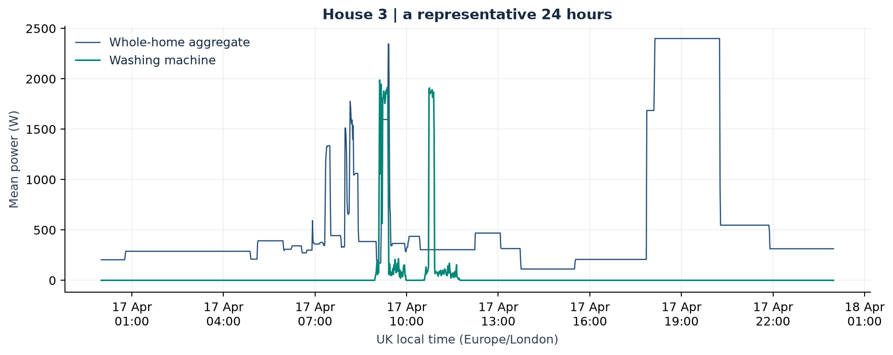
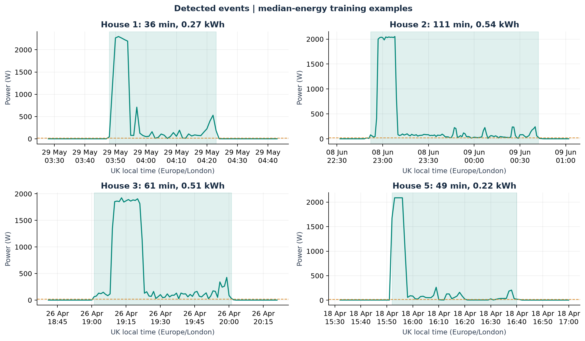
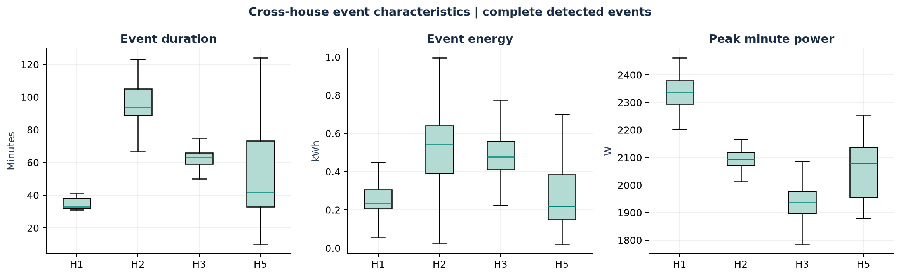
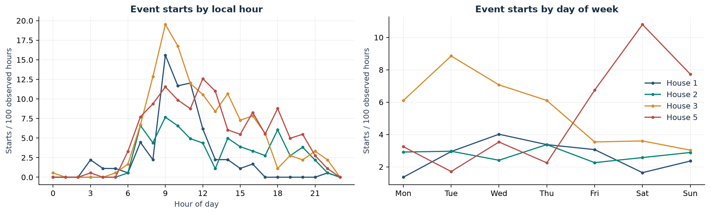
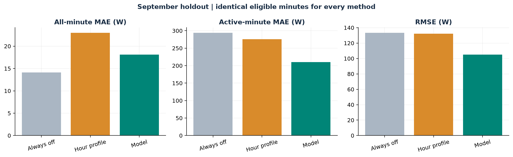
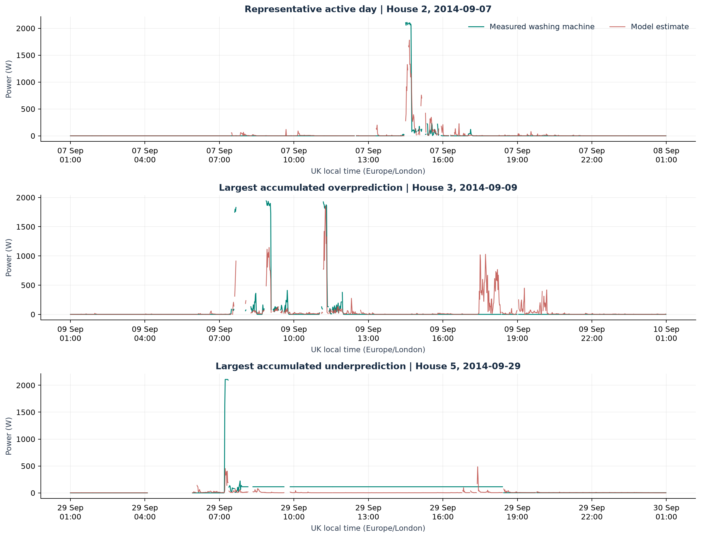

# Results: usage, disaggregation and failure analysis

## What the experiment establishes

Four UK homes are observed from April through September 2014. On the eligible September minutes, the selected model has **18.10 W MAE**, **105.08 W RMSE**, and **210.30 W active-minute MAE**. RMSE improves by **21.2% relative to always-off**, but all-minute MAE is worse (18.10 versus 14.11 W). Activity precision is only **28.5%**, with **47.7% recall**. These are conditional results on the filtered cohort, not accuracy claims for all households or calendar minutes.

**Decision:** retain this as a research prototype. Total energy bias of -4.3% hides cancellation between households: House 1's energy error is +72.2% and House 5's is -40.9%. The better aggregate energy total does not establish accurate individual customer feedback. No model changes were made in response to the final test scores.

## 1. Washing-machine use

House 1 uses Appliance5, House 2 Appliance2, House 3 Appliance6 and House 5 Appliance3. Units are watts; analyses use one-minute means. All period boundaries are stated in DATA.md.

| house   | valid_days_equivalent   | zero_pct   | off_pct   | candidate_events   | complete_events   | events_per_30_observed_days   | median_duration_min   | median_energy_kwh   |
|:--------|:------------------------|:-----------|:----------|:-------------------|:------------------|:------------------------------|:----------------------|:--------------------|
| 1       | 179.126                 | 97.701     | 98.167    | 121                | 116               | 19.428                        | 33.000                | 0.231               |
| 2       | 181.919                 | 94.408     | 95.340    | 128                | 121               | 19.954                        | 94.000                | 0.544               |
| 3       | 179.342                 | 92.957     | 93.786    | 258                | 237               | 39.645                        | 63.000                | 0.477               |
| 5       | 181.947                 | 35.715     | 91.858    | 258                | 224               | 36.934                        | 42.000                | 0.218               |

`zero_pct` is exactly zero; `off_pct` is at or below 20 W. Denominators use observed washer minutes. Equivalent days are observed minutes divided by 1,440, not a count of complete days. Detected-event rates remain vulnerable to outages and censored events and are not unbiased estimates of washing frequency.

**Event rule:** start with minutes above 20 W; join active periods separated by at most 10 observed off minutes; require at least 10 elapsed minutes and 0.02 kWh. Never join across missing minutes. An event without a full observed 10-minute buffer on each side is labelled censored. Duration and energy comparisons use complete events only. Energy is the sum of one-minute mean watts divided by 60,000, including observed pauses within the event. This heuristic can split long soak phases or merge closely spaced uses; events are not independently verified cycles.

**Interpretation:** the aggregate contains other household loads as well as the washer. A washer activation is not uniquely identifiable from the height of a household power peak. The example day contains a training-period event closest to the overall median event energy; it was not selected for a favourable model prediction.

**Interpretation:** shaded intervals show the event grouping, and the dashed line marks the activity threshold. Within-cycle pauses explain why a single threshold crossing should not be counted as a complete wash. Examples are nearest to each house's median training-event energy.

**Interpretation:** distributions, rather than only averages, show variation between detected events and homes. Extreme points are omitted from the boxplot display for readability, not deleted from the event table. These differences cannot identify efficiency without information about programme, load size and appliance use.

House 2 has a median detected duration of 94 minutes and median event energy of 0.54 kWh, compared with 33 minutes and 0.23 kWh in House 1. That is a difference in observed programmes/events, not evidence that one household is wasteful.

**Interpretation:** starts are expressed per 100 observed hours within each hour/day category, preventing different observation coverage from masquerading as different usage intensity. Local time is Europe/London. These are event-start patterns, not the fraction of electricity used at each time.

House 1: highest observed start rate at 09:00–10:00 local time and on Wednesday. House 2: highest observed start rate at 09:00–10:00 local time and on Thursday. House 3: highest observed start rate at 09:00–10:00 local time and on Tuesday. House 5: highest observed start rate at 12:00–13:00 local time and on Saturday. These are descriptive peaks from a small household sample; no statistical significance or universal washing schedule is implied.

### Sensitivity of cycle counts

Thresholds 10, 20 and 50 W are crossed with pause allowances 5, 10 and 15 minutes. The resulting range of complete-event counts is:

| house   | min   | max   |
|:--------|:------|:------|
| 1       | 109   | 128   |
| 2       | 117   | 174   |
| 3       | 227   | 249   |
| 5       | 212   | 240   |

The full grid is in [event_sensitivity.csv](artifacts/tables/event_sensitivity.csv). Variation is evidence that the counts depend on the rule; it is not a confidence interval. No rule is tuned to maximise test performance.

## 2. Validation design

Train on April–July, compare two candidate losses in August, and evaluate once on September. All four homes appear in the primary chronological experiment. A separate model uses only Houses 1, 2 and 3 during both training and validation, then predicts September in unseen House 5.

| split      | house   | start_utc   | end_utc_exclusive   | calendar_minutes   | eligible_minutes   | active_minutes   |
|:-----------|:--------|:------------|:--------------------|:-------------------|:-------------------|:-----------------|
| train      | 1       | 2014-04-01  | 2014-08-01          | 175,680            | 167,172            | 1,950            |
| train      | 2       | 2014-04-01  | 2014-08-01          | 175,680            | 168,554            | 6,433            |
| train      | 3       | 2014-04-01  | 2014-08-01          | 175,680            | 155,279            | 7,677            |
| train      | 5       | 2014-04-01  | 2014-08-01          | 175,680            | 148,978            | 5,573            |
| validation | 1       | 2014-08-01  | 2014-09-01          | 44,640             | 39,096             | 427              |
| validation | 2       | 2014-08-01  | 2014-09-01          | 44,640             | 41,530             | 1,403            |
| validation | 3       | 2014-08-01  | 2014-09-01          | 44,640             | 37,948             | 1,578            |
| validation | 5       | 2014-08-01  | 2014-09-01          | 44,640             | 32,074             | 1,136            |
| test       | 1       | 2014-09-01  | 2014-10-01          | 43,200             | 38,301             | 585              |
| test       | 2       | 2014-09-01  | 2014-10-01          | 43,200             | 41,249             | 1,754            |
| test       | 3       | 2014-09-01  | 2014-10-01          | 43,200             | 37,778             | 1,256            |
| test       | 5       | 2014-09-01  | 2014-10-01          | 43,200             | 36,932             | 3,564            |

Features are current aggregate power; lags of 1, 2, 5, 10, 15, 30 and 60 minutes; 5/15/30/60-minute rolling mean, standard deviation, minimum and maximum; one-minute change; and current power above the past-hour minimum. All are causal. Each split builds its own history. A complete 61-minute aggregate context is required, and missing targets are never imputed. Target/quality exclusions apply at the predicted minute, not to every historical washer reading.

The feature matrix includes no appliance signals, target-derived cycles, house identity or calendar cues. The model is histogram gradient boosting with 180 iterations, 31 leaves, learning rate 0.08, minimum leaf size 40 and L2 regularisation 10. Squared-error and Poisson losses are compared using macro-averaged household RMSE on validation. A fixed seed and no internal random early-stopping split make the procedure reproducible. Predictions are clipped to zero through current aggregate power. The selected model is not refit after validation.

| experiment    | loss          | macro_rmse_w   | status                          | selected   |
|:--------------|:--------------|:---------------|:--------------------------------|:-----------|
| chronological | squared_error | 85.798         | valid                           | Yes        |
| chronological | poisson       | not scored     | rejected: numerical instability | No         |
| unseen_house5 | squared_error | 96.234         | valid                           | Yes        |
| unseen_house5 | poisson       | 121.811        | valid                           | No         |

Candidates producing numerical runtime warnings or nonfinite validation predictions are rejected before selection; clipping is never used to conceal an unstable candidate.

Baselines are **always-off** and **house/hour mean washer power learned on training only**. The profile receives house and local-hour information explicitly as a benchmark. No target labels from validation or test enter it.

## 3. September test performance

| model             | n_minutes   | mae_w   | rmse_w   | active_mae_w   | precision   | recall   | f1    |
|:------------------|:------------|:--------|:---------|:---------------|:------------|:---------|:------|
| always_off        | 154,260     | 14.110  | 133.422  | 294.184        | 0.000       | 0.000    | 0.000 |
| hour_profile      | 154,260     | 23.006  | 132.168  | 275.549        | 0.080       | 0.372    | 0.132 |
| gradient_boosting | 154,260     | 18.096  | 105.076  | 210.298        | 0.285       | 0.477    | 0.357 |

Energy on the same eligible minutes:

| model             | actual_kwh   | predicted_kwh   | energy_error_pct   | daily_energy_mae_kwh   |
|:------------------|:-------------|:----------------|:-------------------|:-----------------------|
| always_off        | 36.278       | 0.000           | -100.000           | 0.302                  |
| hour_profile      | 36.278       | 29.565          | -18.503            | 0.276                  |
| gradient_boosting | 36.278       | 34.723          | -4.285             | 0.191                  |

- **MAE:** typical absolute power error over all eligible minutes. Low values can conceal missed activity because off minutes dominate.
- **RMSE:** penalises large power errors; validation selection uses the equal-house average.
- **Active MAE:** error only where measured washer power exceeds 20 W, exposing always-off failure.
- **Precision/recall/F1:** minute-level activity at the same 20 W threshold, not event matching. False-positive behaviour is visible through precision.
- **Energy error:** signed relative bias over exactly the eligible minutes, not a complete-month bill estimate. Positive means overprediction.
- **Daily energy MAE:** absolute error in each observed household-day's eligible energy. This prevents cancellation between different days, but partial days remain partial.

**Interpretation:** compare all-minute error with active-minute error before claiming success. A model may improve large-load reconstruction while worsening typical-minute error or producing false positives. No single metric is sufficient for a utility decision.

Here that trade-off is visible: active-minute MAE falls from 294.2 to 210.3 W, but overall MAE rises by 3.99 W. Daily eligible-energy MAE falls from 0.302 to 0.191 kWh. The model is useful for studying load reconstruction, but its low activity precision would create too many unreliable customer alerts at this threshold.

### Results by household

| house   | model             | mae_w   | rmse_w   | active_mae_w   | f1    | energy_error_pct   |
|:--------|:------------------|:--------|:---------|:---------------|:------|:-------------------|
| 1       | always_off        | 3.901   | 63.251   | 252.098        | 0.000 | -100.000           |
| 2       | always_off        | 17.714  | 172.579  | 414.603        | 0.000 | -100.000           |
| 3       | always_off        | 15.102  | 151.331  | 453.742        | 0.000 | -100.000           |
| 5       | always_off        | 19.658  | 116.254  | 185.598        | 0.000 | -100.000           |
| 1       | hour_profile      | 6.692   | 62.972   | 242.261        | 0.090 | -19.258            |
| 2       | hour_profile      | 29.820  | 171.339  | 393.195        | 0.130 | -20.417            |
| 3       | hour_profile      | 30.891  | 149.683  | 414.939        | 0.165 | 22.375             |
| 5       | hour_profile      | 24.250  | 114.648  | 173.991        | 0.061 | -48.543            |
| 1       | gradient_boosting | 7.780   | 58.861   | 174.744        | 0.387 | 72.187             |
| 2       | gradient_boosting | 20.941  | 131.342  | 280.361        | 0.353 | -9.136             |
| 3       | gradient_boosting | 19.995  | 105.988  | 248.834        | 0.421 | 28.551             |
| 5       | gradient_boosting | 23.676  | 108.469  | 168.072        | 0.302 | -40.943            |

The paired household-day bootstrap estimates model-minus-always-off MAE at **+3.99 W**, with a 95% percentile interval **[+2.80, +5.47] W**, using 1,000 within-house day resamples. Negative favours the model. This describes uncertainty conditional on the observed four homes and September; adjacent days may remain correlated and household population uncertainty is not represented.

### Sparse-minute sensitivity

Restrict evaluation to minutes with at least five readings in both target and aggregate, leaving the fitted model unchanged:

| model             | n_minutes   | mae_w   | rmse_w   | active_mae_w   | f1    | energy_error_pct   |
|:------------------|:------------|:--------|:---------|:---------------|:------|:-------------------|
| always_off        | 146,134     | 14.368  | 134.192  | 292.176        | 0.000 | -100.000           |
| hour_profile      | 146,134     | 23.315  | 132.895  | 273.533        | 0.134 | -19.054            |
| gradient_boosting | 146,134     | 18.424  | 105.982  | 209.687        | 0.357 | -4.757             |

This tests the effect of sparse target bins; it does not certify the quality of every minute in the preceding feature window. The initial data audit showed that enforcing five readings throughout every 61-minute history discarded most activity, so sparse bins are retained with disclosure rather than silently interpreted as outages.

### Unseen-house diagnostic

| model             | n_minutes   | mae_w   | rmse_w   | active_mae_w   | f1    | energy_error_pct   |
|:------------------|:------------|:--------|:---------|:---------------|:------|:-------------------|
| gradient_boosting | 36,932      | 23.175  | 110.065  | 173.969        | 0.256 | -54.140            |
| always_off        | 36,932      | 19.658  | 116.254  | 185.598        | 0.000 | -100.000           |

House 5 is never used to fit or choose this transfer model. Compare with the primary House 5 result above. A single held-out house is a diagnostic, not a cross-house benchmark. Neither experiment establishes India transfer.

## 4. Predictions and concrete failure cases

| label                               | house   | date                      | actual_kwh   | predicted_kwh   | excess_kwh   | missed_kwh   |
|:------------------------------------|:--------|:--------------------------|:-------------|:----------------|:-------------|:-------------|
| Representative active day           | 2       | 2014-09-07 00:00:00+00:00 | 0.553        | 0.509           | 0.187        | 0.231        |
| Largest accumulated overprediction  | 3       | 2014-09-09 00:00:00+00:00 | 1.026        | 1.127           | 0.587        | 0.487        |
| Largest accumulated underprediction | 5       | 2014-09-29 00:00:00+00:00 | 1.512        | 0.197           | 0.060        | 1.375        |

The first panel is a median-energy eligible active test day. The remaining panels deliberately show the greatest accumulated overprediction and underprediction in held-out household-days. `excess_kwh` sums positive minute errors and `missed_kwh` sums negative minute errors in magnitude, before cancellation; their difference is the net energy error. These examples are selected for diagnosis after scoring, not for tuning. Plot gaps indicate excluded minutes.

**False activation / overestimated load:** other appliances can resemble washer heating or motor operation. The largest overprediction example makes this ambiguity visible; without inspecting competing submeters, the exact appliance causing a peak cannot be asserted.

**Missed or underestimated activity:** low-power phases can be buried in aggregate variation, and learned average power can smooth short heating peaks. The largest underprediction day shows the cost in energy. Different machines and programmes can produce different patterns even for the same appliance class.

The House 5 failure also contains a long, almost constant measured target plateau. It should not automatically be interpreted as a real uninterrupted wash: a persistent appliance state or upstream data filling could contribute. Raw-channel inspection or independent event labels would be needed to distinguish these possibilities. This example exposes uncertainty in both the estimate and its reference labels.

## 5. Limits and next experiment

Labels inherit upstream filling and zero replacement. Missingness and quality exclusions can be related to appliance activity, so coverage filtering can bias evaluation. Household differences, a single season/window, heuristic cycle boundaries, and no independent cycle labels limit interpretation. Bootstrap intervals do not resolve these issues. The next priority is raw-to-clean label auditing and manually reviewed event labels across more homes, followed by leave-one-home-out evaluation and an intervention pilot. Recommendations and the 15/30-minute discussion are in [Recommendation.md](Recommendation.md).

All figures derive from REFIT measurements, credited to Murray, Stankovic and Stankovic / University of Strathclyde, CC BY 4.0. See [README.md](README.md) for sources and AI assistance disclosure.
